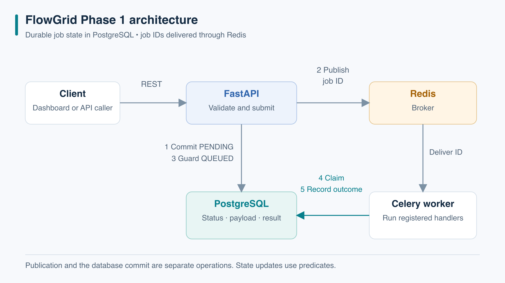
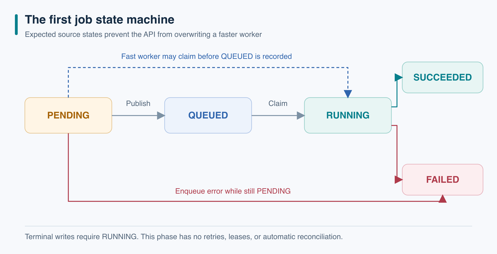

# Building FlowGrid from API Request to Background Worker

*Part 1 of 3 · Building a distributed workflow and task orchestration platform*

A background job system starts with a simple promise: accept work now, execute it elsewhere, and let the caller find out what happened. The first difficult question is what the system should say when its API, database, and workers disagree about where that work has reached.

I built FlowGrid to explore that question. The first phase connects a FastAPI endpoint to PostgreSQL, Redis, and a Celery worker. It deliberately stops at one complete execution path. Retries, authentication, and workflows arrive in later phases.

The most useful result was a state model that could survive the API and a fast worker updating the same job at almost the same time.

## Keeping job state in PostgreSQL

The architecture has four main components. FastAPI validates and accepts requests. PostgreSQL stores the job, its payload, its status, and its eventual result. Redis transports execution messages. Celery workers load jobs and run registered handlers.



*Figure 1. PostgreSQL owns execution state. Redis carries a job ID, which the worker resolves against the database.*

The message contains only the job ID. The worker reads the type and payload from PostgreSQL, and `task_ignore_result=True` disables Celery result storage. A status lookup therefore has one authoritative answer.

That choice also makes the durability boundary clear. A durable database row preserves job history even when Redis loses messages. Recovering the missing execution message is a separate responsibility, added later.

The initial handler registry contains `echo`, `sleep`, `process_records`, and `always_fail`. Clients choose a registered type and submit data; they cannot upload executable code.

## Saving work before publishing it

Submitting a job crosses two independent systems. PostgreSQL can commit a row, and Redis can accept a message, but these operations do not share a transaction.

FlowGrid performs them in this order:

1. Validate the request and commit a job as `PENDING`.
2. Publish its ID to Redis.
3. Change its status from `PENDING` to `QUEUED`.

The first commit matters because a worker must never receive an ID before the corresponding row exists.

`PENDING` means that publication has not been confirmed in the database. If the API crashes after saving the job but before publishing it, the row stays in a state that exposes the unfinished handoff. Phase 1 does not repair that state automatically; Phase 2 adds the recovery loop.

If publication raises an exception in Phase 1, the API attempts a guarded transition to `FAILED`, records the enqueue error, and returns `503` with the job ID. A broker exception can be ambiguous about whether a message reached Redis, so this response describes the publication failure rather than proving that no worker could have received the job.

## Guarding transitions against races

Consider a fast worker. Redis accepts the message, the worker immediately claims the job, and the job becomes `RUNNING`. Only then does the API reach its final update.

An unconditional `UPDATE` would move the job backward to `QUEUED`.

The Phase 1 transition helper prevents that by including the expected source state in its predicate. Its central operation is:

```python
stmt = (
    update(Job)
    .where(
        Job.id == job_id,
        Job.status.in_([s.value for s in from_statuses]),
    )
    .values(status=to_status.value, updated_at=now, **values)
    .execution_options(synchronize_session=False)
)
result = db.execute(stmt)
db.commit()
return result.rowcount == 1
```

The API can record `QUEUED` only while the row is still `PENDING`. If the worker has already changed it, the API update matches zero rows.



*Figure 2. The worker may claim either PENDING or QUEUED. The dashed path captures the race that makes an unconditional API update unsafe.*

The same pattern protects claims. Two workers receiving the same ID both attempt `PENDING/QUEUED → RUNNING`; only one can win the guarded update. Under PostgreSQL READ COMMITTED, a competing updater waits for the first update and then rechecks its predicate against the changed row. [PostgreSQL documents this update behavior](https://www.postgresql.org/docs/16/transaction-iso.html).

Outcome writes also require `RUNNING`, preventing a late failure write from replacing an already recorded success. These guards protect the state transitions available in Phase 1. They do not establish exactly-once execution, and retries will require an additional attempt-level guard.

The executor keeps its own claim and outcome transactions short. Handler execution sits between them, outside those transactions, so a sleeping handler does not keep a claim transaction open for its entire runtime.

## Rejecting invalid work before it becomes a job

Each handler declares a Pydantic payload model. Unknown job types and invalid payloads return `422` before a job row is created. Payload models reject extra fields, and the database stores the normalized payload with defaults filled in.

This is useful for both correctness and inspection. A caller sees a field-level error immediately, and the stored payload shows what the worker will receive.

`process_records` also distinguishes a failed record from a failed job. An invalid record ID contributes to the handler's `failed` count; the handler can still complete successfully with useful results. An exception escaping the handler fails the job itself. That distinction becomes important when deciding which failures should trigger a retry.

The API exposes the handler schemas through `/api/v1/job-types`, which the static dashboard uses to build submission forms. Other endpoints submit jobs, inspect individual results, filter job history, and return status counts. A successful submission returns `202 Accepted` because the work is asynchronous.

## What integration testing caught

One state test exposed a stale SQLAlchemy object. A bulk update used `synchronize_session=False`, leaving an existing `Job` instance unchanged in the session's identity map. A subsequent `db.get()` returned that cached instance. Reloading with `populate_existing=True` made the read reflect the database.

Another failure appeared only when the real worker connected to Redis. The initial dependency constraint installed a redis-py version below the transport's required version. Eager Celery tests passed because they never opened the broker connection. The worker container did not.

The build also encountered a Docker issue involving the em dash in the project directory and the Compose build path. The repository addressed it by sharing one application image across services and setting `COMPOSE_BAKE=false` in the Makefile.

These failures gave each validation layer a clear purpose. Unit tests check handler behavior and state rules. A smoke test checks the real HTTP, database, broker, and worker path.

## What Phase 1 established

At the Phase 1 milestone, the build log recorded 30 passing tests on SQLite and PostgreSQL, plus seven smoke checks against the container stack. The smoke checks covered successful and failed jobs, observable `RUNNING` state, input rejection, record processing, and a small burst of submissions.

That burst was a functional check. It was not a capacity benchmark; the workloads and client polling were not designed to measure maximum throughput.

The remaining failure modes were substantial. A killed worker could leave a job `RUNNING`. A stranded `PENDING` row had no reconciler. Handlers had no timeout, jobs had no retry policy, and the API had no authentication. The dashboard polled every two seconds.

What this phase did establish was a complete, inspectable path from submission to recorded outcome, with database guards around the transitions where processes could race. Phase 2 builds recovery around those same states: deciding when a retry is justified, detecting abandoned work, and making repeated execution safe for the effects the system controls.
