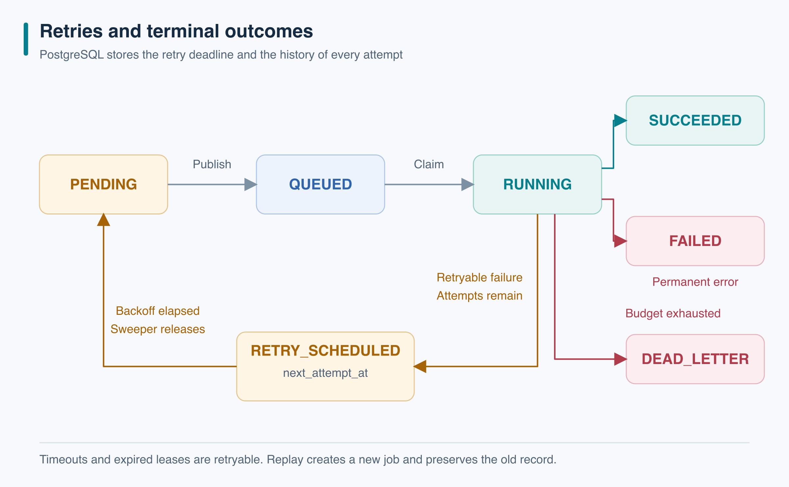
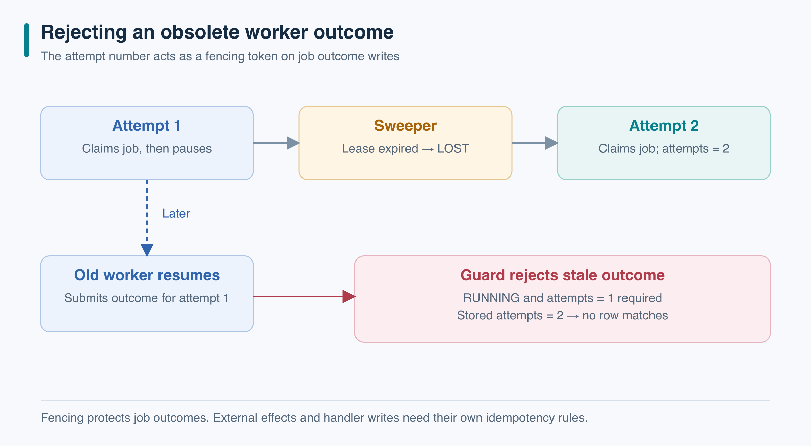

# Making FlowGrid Jobs Recover from Crashes and Retries

*Part 2 of 3 · Building a distributed workflow and task orchestration platform*

A worker can disappear after committing half a batch. A client can retry a request whose response was lost. Redis can be unavailable while PostgreSQL is still accepting writes. Each failure raises a different question, and adding a retry loop answers only some of them.

Phase 1 of FlowGrid established the path from FastAPI to a Celery worker, with PostgreSQL storing execution state and Redis carrying job IDs. Phase 2 adds recovery around that path: retry policy, attempt history, time limits, leases, durable publication, idempotency, and API access controls.

The central distinction is between recovering execution and protecting effects. A job can run again after a crash. Whether that repeats a business action depends on how the handler performs that action.

## Giving failures different outcomes

FlowGrid separates permanent failures from transient ones. An explicit exception allow-list classifies `TransientJobError`, `SoftTimeLimitExceeded`, `TimeoutError`, and `ConnectionError` as retryable. Other exceptions, including programming errors such as `KeyError`, stop the job.

A permanent error produces `FAILED`. A retryable error produces `RETRY_SCHEDULED` while attempts remain, then `DEAD_LETTER` when the budget is exhausted. These are application states persisted in PostgreSQL.



*Figure 3. Retryable failures wait in PostgreSQL before returning to PENDING. Permanent errors and exhausted retry budgets have different terminal states.*

Each execution attempt gets a separate `job_attempts` row containing its worker, timestamps, outcome, and error classification. An attempt can finish as `SUCCEEDED`, `FAILED`, `TIMED_OUT`, or `LOST`.

Replay creates a new job with `replay_of` pointing to the original. The original failure and attempt history remain available for inspection.

## Scheduling retries in the database

The backoff policy uses equal jitter:

```python
exp = min(cap, base * (2 ** (attempt - 1)))
delay = exp / 2 + rng() * exp / 2
```

With a two-second base, the first retry waits roughly one to two seconds, the second two to four, and the third four to eight. The exponential ceiling is capped at 300 seconds. Randomizing part of the delay spreads retries after a shared dependency recovers.

FlowGrid persists `RETRY_SCHEDULED` and `next_attempt_at` in PostgreSQL. A sweeper releases due retries to `PENDING` and attempts publication.

This keeps timing visible in the same durable store as job state. Celery ETA and countdown tasks can reside in worker memory before execution, and Redis visibility timeouts affect their redelivery. Worker loss does not imply that every countdown task is permanently lost; the broker and acknowledgement behavior matter. The motivation here is explicit database scheduling and reconciliation. [Celery describes these ETA and countdown caveats](https://docs.celeryq.dev/en/stable/userguide/calling.html#eta-and-countdown).

## Detecting abandoned attempts with leases

Each publication sets a soft time limit of `timeout_seconds` and a hard limit five seconds later. The soft limit raises an exception that the executor can record as `TIMED_OUT`; the hard limit provides a process-level termination mechanism in the configured prefork worker setup.

At claim time, FlowGrid records:

```text
lease_expires_at = claim_time + timeout_seconds + lease_grace_seconds
```

The default grace is 15 seconds. The sweeper treats an expired lease as evidence that the attempt should be recovered, records `LOST`, and schedules a retry or dead-letters the job.

This avoids heartbeat-based lease extension, at the cost of waiting for the original deadline when a worker dies early. It is a failure detector, rather than proof that a paused process can never resume. Attempt fencing handles stale outcome writes if it does.

The deadline is also not a bound on completion after a crash. Detection waits until the lease expires, and completion additionally depends on the next sweep, retry backoff, broker availability, queue wait, and the replacement attempt's runtime. In the recorded chaos run, an eight-second timeout and 15-second grace contributed to recovery that completed about 32 seconds after the kill.

## Recovering the database to broker handoff

The sweeper runs periodically and recovers expired leases, releases due retries, republishes stale `PENDING` jobs, and removes old request-idempotency records.

The publication change is particularly useful during a Redis outage. The API commits the job as `PENDING`, tries to publish, and returns `202` even when publication fails. PostgreSQL has accepted responsibility for the work; the sweeper can publish it later.

The jobs table serves as an outbox: its state identifies work that still needs a handoff. Recovery proceeds through `PENDING` so that a failed retry publication uses the same repair path as a failed initial publication.

Several sweepers may inspect the same row. Guarded transitions prevent competing state changes from both winning, while duplicate publication remains possible. The worker claim must therefore tolerate repeated messages.

## Protecting state when delivery repeats

Phase 2 enables `task_acks_late=True` and `task_reject_on_worker_lost=True`. These settings support redelivery after worker loss. They also mean the application must handle delivery more than once.

FlowGrid uses three distinct protections.

**The guarded claim** accepts only `PENDING` or `QUEUED`. A duplicate delivery while the job is running or terminal cannot claim another attempt from those states.

**The attempt fence** protects outcomes after recovery. Imagine attempt 1 pauses, its lease expires, and attempt 2 starts. If the old worker resumes, checking only `status='RUNNING'` would be insufficient: the job is running again, but under different authority.

The success update also requires the attempt number to match. In SQL terms, its core predicate is:

```sql
UPDATE jobs
SET status = 'SUCCEEDED'
WHERE id = :job_id
  AND status = 'RUNNING'
  AND attempts = :attempt;
```



*Figure 4. A worker from attempt 1 cannot record an outcome after the job has moved to attempt 2. This fence protects job state; business effects need their own protection.*

**Idempotent handler writes** protect the example's database effects. `process_records` inserts processed rows using the business key `(batch_id, record_id)`. Notification rows use `record-processed:{batch_id}:{record_id}` as a unique deduplication key. Repeating the work does not create another row for the same key.

The notification insert uses `ON CONFLICT DO NOTHING ... RETURNING id` to distinguish a new insert from a duplicate. The original `rowcount` check behaved differently across the tested drivers; the returned ID made the check explicit.

The recorded failure-injection scenario committed part of a 500-record batch and raised a transient error. After the retry, the database contained 500 processed records and 500 notification rows.

Those notification rows are an outbox representation. FlowGrid does not deliver real email or SMS messages in this implementation, and the result field named `notifications_sent` counts inserted notification rows. An external delivery integration would need its own deduplication contract.

## Handling repeated client requests

Request idempotency solves a separate problem: the client retries a POST because it did not receive the response.

For `POST /api/v1/jobs`, a new `Idempotency-Key` is stored in the same transaction as the new job. Reusing it with the same normalized request returns the original job with `200` and `Idempotent-Replayed: true`. Reusing it with a different request returns `409`.

The key is scoped to the caller's API key. Hashing the normalized request means omitted defaults and explicitly supplied defaults compare consistently. A database uniqueness constraint resolves competing inserts.

Records become eligible for cleanup after 24 hours and are removed by the sweeper. The practical reuse boundary is deletion: once the record is gone, the same key can create another job. Stopping the sweeper can extend retention beyond the configured age.

## Controlling access and request volume

API keys are generated from 32 random bytes. The database stores a SHA-256 hash and a short display prefix; creation returns the raw key once. Jobs belong to the creating key, and ownership filters make another client's job look absent with `404`.

The Redis token bucket allows a burst capacity of 100 requests and refills at 20 tokens per second. A Lua script updates it atomically using Redis time. When exhausted, it returns `429` with `Retry-After`.

The limiter fails open during a Redis outage, preserving the API's ability to accept durable `PENDING` work. This is an explicit availability tradeoff. Invalid credentials are rejected separately, and this limiter does not rate-limit unauthenticated traffic.

Input bounds cap attempt budgets and timeouts. A middleware rejects declared bodies over 1,000,000 bytes using `Content-Length`; it does not enforce a streaming byte limit on chunked requests without that header.

Structured JSON logging adds request IDs to API logs and job IDs, attempt numbers, and worker IDs to execution logs. That context makes it possible to follow one attempt across handler and executor messages.

## What the failure tests established

The Phase 2 build log recorded 80 passing tests on each database, 11 smoke checks, and five chaos scenarios. Those scenarios covered worker termination, repeated timeout to dead letter, Redis unavailability, partial batch work followed by retry, and duplicate message delivery.

They demonstrate particular recovery paths. They do not make arbitrary external effects exactly once, and Phase 2 still has a delivery gap: a job can remain `QUEUED` if Redis loses its already-published message. The outbox repair at this stage only revisits `PENDING` rows.

Phase 3 closes that gap and composes jobs into dependency graphs. The same claim, lease, retry, and fencing mechanisms will apply to each workflow step, while a separate advancement process decides when its dependents can run.
