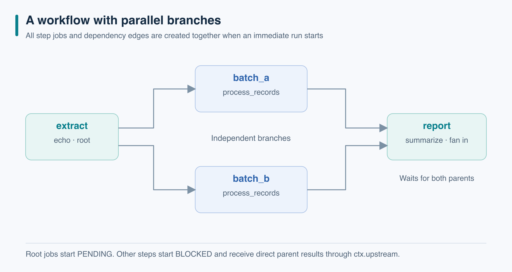
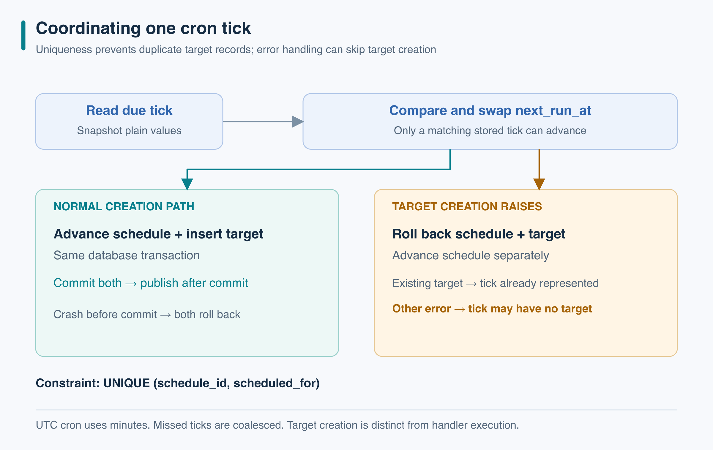
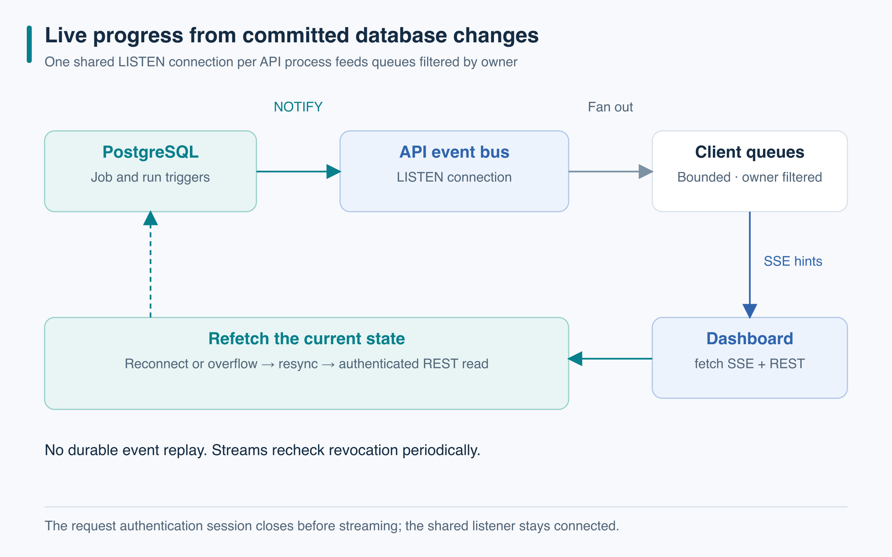
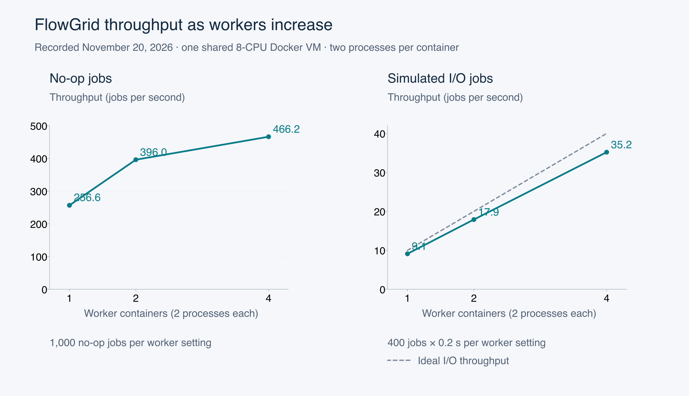

# Adding Workflow Orchestration Scheduling and Live Monitoring to FlowGrid

*Part 3 of 3 · Building a distributed workflow and task orchestration platform*

Reliable jobs become more useful when they can depend on one another. An import may extract data, process two batches in parallel, and produce a report only after both batches succeed. That introduces a new failure mode: every individual job can finish correctly while the workflow remains stuck.

The third phase of FlowGrid adds dependency graphs, delayed execution, recurring schedules, live events, operational metrics, and measurements at several worker counts. It keeps the earlier architecture: PostgreSQL holds state, Redis transports job IDs, Celery executes handlers, and a sweeper repairs unfinished coordination.

## Building workflows from ordinary jobs

`POST /api/v1/workflows` accepts steps with a job type, payload, and optional `depends_on` list. This complete request describes a small diamond graph:

```json
{
  "name": "record-import",
  "steps": [
    {"id": "extract", "type": "echo", "payload": {"message": "start"}},
    {"id": "batch_a", "type": "process_records", "depends_on": ["extract"],
     "payload": {"batch_id": "import-a", "record_ids": [1, 2, 3]}},
    {"id": "batch_b", "type": "process_records", "depends_on": ["extract"],
     "payload": {"batch_id": "import-b", "record_ids": [4, 5]}},
    {"id": "report", "type": "summarize", "depends_on": ["batch_a", "batch_b"]}
  ]
}
```



*Figure 5. A dependent step becomes eligible only after all its direct parents succeed. Parallel branches use ordinary job execution and retry handling.*

Validation checks duplicate IDs, unknown and self-referencing dependencies, registered job types, and handler payloads. When those structural and payload checks pass, Kahn's topological-sort algorithm detects cycles. Unprocessed nodes indicate a cycle or a dependency downstream of one; they are not necessarily all members of the cycle itself.

Starting an immediate run creates the run, every step job, and every dependency edge in one transaction. Root steps start as `PENDING`; dependent steps start as `BLOCKED`. Publication happens after the commit. A delayed run initially stores the run and materializes its steps when it starts.

Each materialized step uses the existing attempts, leases, timeouts, retry policy, and outcome fencing. Direct parent results are supplied through `ctx.upstream`. The `summarize` handler can combine branch results without inventing a second execution system.

## Advancing runs after committed outcomes

`advance_run` evaluates the graph after a step reaches a terminal outcome. It unblocks eligible dependents, completes an all-successful run, or fails the run when a step becomes `FAILED` or `DEAD_LETTER`.

A transient error awaiting retry does not fail the workflow. Its dependents remain blocked. When the run fails, steps still eligible for cancellation are cancelled; attempts already running may finish and record their results. This does not roll back their effects.

The transaction boundary matters when two sibling steps finish concurrently. Suppose `report` depends on both branches. If each branch writes its own success and checks the other branch before committing, both can miss the other's uncommitted change and leave `report` blocked.

FlowGrid commits the outcome first, then evaluates advancement in a separate transaction. For these successful sibling completions under READ COMMITTED, the branch that commits last begins its later graph read after both successes are committed. A guarded `BLOCKED → PENDING` update resolves competing attempts to release the same child. [PostgreSQL defines READ COMMITTED visibility per statement](https://www.postgresql.org/docs/16/transaction-iso.html).

There is still a crash window between committing success and invoking advancement. The sweeper looks for running workflows whose stored state calls for action: a ready blocked step, a terminal failed step, or an entirely successful set of steps. It then repeats the advancement operation.

A recovery test covers this window by committing successes without advancement and letting the sweeper repair the run. A separate repeat-call test checks that evaluating the same ready graph twice publishes the dependent step only once.

## Giving time a durable representation

A future `run_at` or `delay_seconds` creates a standalone job in `SCHEDULED`, with its release time in `next_attempt_at`. The sweeper releases due scheduled jobs through the same `PENDING` publication path used for retries.

Recurring schedules accept five-field cron expressions in UTC, at minute resolution. Their coordination has two layers:

- A compare-and-swap update advances `next_run_at` only if it still equals the tick the sweeper read.
- A unique `(schedule_id, scheduled_for)` pair prevents duplicate target records for that tick.

On the successful creation path, advancing the schedule and inserting its job or workflow run share a transaction. A crash before commit rolls both back. Publication follows the commit, so the existing outbox path can repair a failed handoff.



*Figure 6. The normal transaction commits the schedule advance with its target. If target creation raises, the implementation rolls back and separately advances the tick.*

That exception path limits the guarantee. An existing target can make a duplicate insert fail, but another creation error can also occur. In both cases the implementation advances the tick separately to avoid retrying it forever; non-integrity errors are logged. Consequently, a tick can be skipped when its target cannot be created. The system prevents duplicate target records for a tick; it does not guarantee one successful execution for every cron occurrence.

Missed ticks are coalesced. After downtime, a due schedule creates one target and moves to the next future occurrence. Resuming a paused schedule also skips the interval while it was paused.

One implementation detail was worth preserving: due ticks are read into plain-value snapshots. A rollback expires SQLAlchemy ORM objects; lazily rereading a schedule advanced by another sweeper could otherwise substitute a future tick into the current iteration.

## Recovering messages that Redis lost

The Phase 2 Redis outage test showed that `PENDING` work could be published after Redis returned. It did not test a message that had already been accepted and was subsequently lost.

A job in that situation remains `QUEUED` in PostgreSQL. Phase 3 adds stale-queue reconciliation: the sweeper republishes jobs whose `queued_at` exceeds `QUEUED_REPUBLISH_AFTER_SECONDS`. The application default is 300 seconds; the supplied Compose setup uses 60 seconds.

If the original message is still present, duplicates can arrive. Claim guards prevent a second delivery from claiming a job that is already running or finished, and attempt fencing still protects outcomes across retries.

A real backlog can also produce stale queued rows. The threshold should therefore be chosen with normal queue wait in mind. Multiple sweepers may issue duplicate publications before timestamps are updated; the timestamp reset is not a global publication lock.

The recorded chaos scenario stopped workers, queued five jobs, flushed Redis, and restarted execution. All five jobs eventually completed with one recorded attempt each.

## Streaming committed changes to the dashboard

PostgreSQL triggers emit small `NOTIFY` messages for relevant job and workflow-run changes. Notification delivery follows transaction commit, so a rolled-back change is not announced. A delivered event can already be older than the current row, which is why the dashboard uses it as a signal to refetch. [PostgreSQL documents transactional notification delivery](https://www.postgresql.org/docs/16/sql-notify.html).



*Figure 7. One database listener per API process feeds client queues. REST reads recover the current state when events are missed.*

The API process keeps a shared `LISTEN` connection and fans events out to bounded in-memory queues filtered by API-key ownership. A slow subscriber receives a `resync` signal when its backlog is dropped. Reconnecting the database listener also asks clients to refetch.

The SSE endpoint closes the authentication database session before streaming so each dashboard does not pin a pooled connection. Temporary authentication and revocation checks still use database connections; the shared listener specifically avoids one permanent listener connection per browser.

The dashboard reads SSE with `fetch()`, which lets it send the bearer token in an authorization header. It parses events, debounces REST refreshes, and falls back to polling while disconnected. Open streams periodically recheck key revocation and terminate with a `revoked` event when needed.

This is a live-update channel, not a durable event log. Reconnecting clients recover from database state rather than replaying every missed notification.

## Measuring operational health

Database-derived metrics expose job and run counts, attempt outcomes, oldest pending and queued ages, overdue scheduled work, expired leases, and enabled schedules. These gauges survive worker restarts because the underlying information is durable.

Each API replica sees the same shared database totals, so summing those totals across replicas would double-count them. The deployment guidance uses a maximum for those gauges. HTTP request counts and latency are local to each API process and need their own aggregation.

HTTP labels use route templates such as `/api/v1/jobs/{job_id}`. Using actual job IDs in labels would create a series per resource. Seven supplied alert rules address backlog, sweeper delay, publication failures, dead letters, expired leases, database reachability, and server errors.

## Measuring worker scaling

The recorded benchmark ran on November 20, 2026, on one Docker VM with eight CPUs. PostgreSQL, Redis, the API, the sweeper, and all workers shared that VM. Each worker container ran two execution processes.

The benchmark submitted 1,000 no-op jobs and 400 simulated I/O jobs, each sleeping for 0.2 seconds, at one, two, and four worker containers. Timing came from database timestamps.



*Figure 8. Separate panels preserve the different throughput scales. The dashed I/O line is the ideal rate from process count divided by 0.2 seconds.*

No-op throughput rose from 256.6 to 396.0 to 466.2 jobs per second. Simulated I/O throughput rose from 9.1 to 17.9 to 35.2 jobs per second, or roughly 88–91% of the simple concurrency-based ideal.

For the I/O workload, end-to-end p50/p95 latency fell from 22.17/41.94 seconds with one container to 5.82/10.89 seconds with four. Queue-wait p50 fell from 21.96 to 5.61 seconds, showing that queueing dominated completion time in those runs.

The result supports a narrow conclusion: adding workers improved throughput substantially for this simulated waiting workload. No-op throughput scaled less strongly on the shared VM. Identifying a specific bottleneck would require profiling; these measurements alone cannot isolate database, broker, API, and CPU contributions.

Across the six runs, the build log reported 4,200 successful jobs with no retries. These are local measurements for the stated setup, rather than a production capacity guarantee or evidence for exactly-once external effects.

## What the three phases achieved

The Phase 3 build log recorded 121 passing SQLite tests with one PostgreSQL-only test skipped, 122 passing PostgreSQL tests, 19 smoke checks, and eight chaos scenarios. The added failure scenarios covered workflow worker loss, Redis message loss, and competing sweepers on two observed cron ticks.

Important boundaries remain. Recovery waits for lease expiry and subsequent scheduling. Running effects are not undone when a workflow fails. Failed workflows have no partial rerun mechanism. Cron uses UTC minutes, and the live channel has no durable replay. Every handler that calls an external service must define how repeated execution affects that service.

Across all three phases, PostgreSQL provides the durable facts, guarded updates control competing writes, and the sweeper turns unfinished handoffs into work that can be tried again. Together, those choices make recovery inspectable: the database shows what happened, what is waiting, and which process still has something to do.
